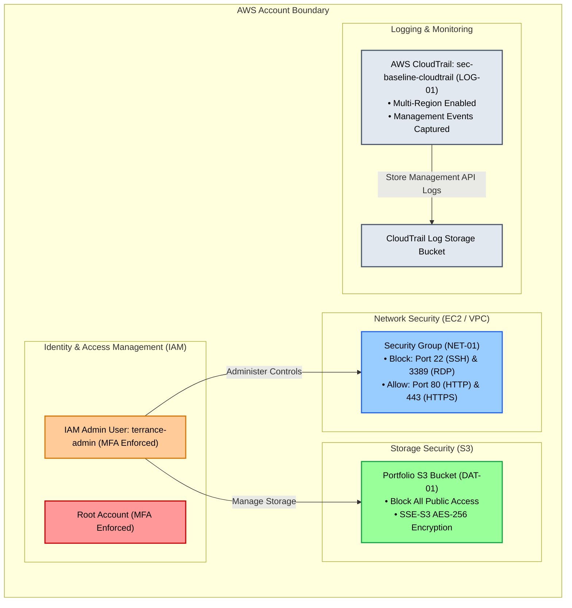

# AWS Cloud Security & GRC Baseline Portfolio

## Executive Summary
This project demonstrates the design, implementation, and audit verification of a foundational **Governance, Risk, and Compliance (GRC)** security baseline on Amazon Web Services (AWS). 

Following industry standards such as **NIST SP 800-53** and **CIS AWS Foundations Benchmarks**, this repository documents five core controls implemented across identity, networking, storage, and audit logging domains.

---

## Security Controls Baseline Summary

| Control ID | Domain | Control Objective | AWS Implementation | Status |
| :--- | :--- | :--- | :--- | :--- |
| **IAM-01** | Identity & Access | Root Account Protection | Enforced Root MFA; deleted root access keys | **100% Compliant** |
| **IAM-02** | Identity & Access | Enforce Least Privilege | Created dedicated administrative user (`terrance-admin`) with MFA | **100% Compliant** |
| **NET-01** | Network Security | Ingress Access Control | Implicit-deny Security Groups restricting management ports (22/3389) | **100% Compliant** |
| **DAT-01** | Data Protection | Prevent S3 Data Exposure | S3 Block Public Access & default SSE-S3 (AES-256) encryption | **100% Compliant** |
| **LOG-01** | Monitoring & Audit | Centralize Activity Logging | Multi-region AWS CloudTrail continuous API logging | **100% Compliant** |

---

## Detailed Audit Evidence & Documentation
Comprehensive evidence files, testing methodologies, and verification logs are maintained in the [`docs/`](./docs) directory:

* 📋 [Controls Matrix Matrix](./docs/controls-matrix.md) — Central tracking of all baseline safeguards.
* 🔐 [Identity & Access Evidence (`IAM`)](./docs/evidence-iam.md) — Documentation for IAM-01 and IAM-02 controls.
* 🌐 [Network Security Evidence (`NET`)](./docs/evidence-net.md) — Firewall rules and ingress security analysis.
* 🛡️ [Data Protection Evidence (`DAT`)](./docs/evidence-dat.md) — S3 security and encryption validation.
* 📜 [Monitoring & Audit Evidence (`LOG`)](./docs/evidence-log.md) — CloudTrail audit configuration details.

---

## Architecture Overview

---

## Author
* **Terrance** — *Cloud Security & GRC Engineering Portfolio*
